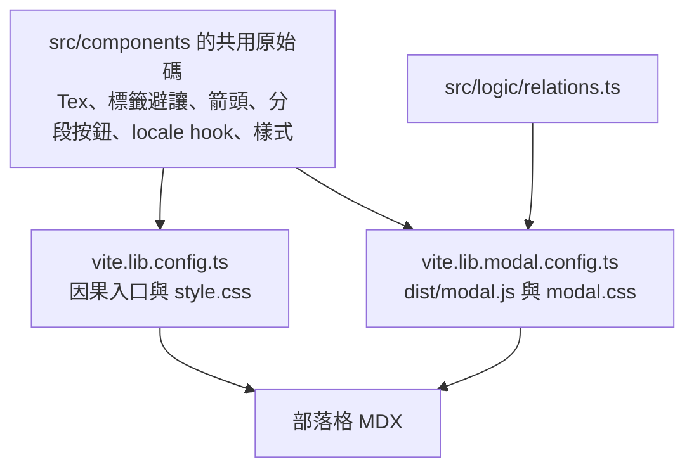

# 模態邏輯與集合論圖的設計文件

> [!IMPORTANT] 結論
> 模態邏輯與集合論的教學圖都放進 `causal-atlas`，以子路徑發佈：先做 `causal-atlas/modal`，之後再做 `causal-atlas/set`；套件名稱不變。
> 兩個子路徑直接沿用 `causal-atlas` 既有的繪圖、標籤避讓、面板、i18n 與樣式程式碼，不複製，也不另立共用套件。
> 第一階段（0.25.0）只做附錄 D 需要的七張圖：內涵表、Kripke 模型、框架條件、實質與嚴格蘊涵、TCS 檢查、同心球（Lewis／Stalnaker）、Pearl 小手術與相似度的對照。
> 每個顯示真值、性質或判定的圖都由引擎計算；只有無窮物件與後設定理用示意。
> 模態另做一次 Vite 建置，把沿用的原始碼打包進 `dist/modal.js`；因果講義用的各入口與 `style.css` 因此與 0.24.6 相同，由既有的大小檢查把關。

本文件原為 `~/projects/logic-atlas/docs/design.md`（獨立 monorepo 的草案）。
決定改放進 `causal-atlas` 後，第 2、3、9、12 節依子路徑佈局重寫，其餘各節保留，只把已定案的記號、術語與名稱改成定案版本。

## 1. 目標與範圍

兩個子路徑的用途，是讓部落格未來的兩個講義系列（模態邏輯、集合論）能像因果系列一樣，在 MDX 裡嵌入可互動、可在伺服器端渲染的教學圖。

- 納入：
  - `causal-atlas/modal`：命題模態邏輯的 Kripke 語意、框架條件與公理對應、條件句語意（嚴格蘊涵、CK、Lewis 同心球、Stalnaker），之後擴到 Garson 的樹法與量化模態邏輯。
  - `causal-atlas/set`：從樸素集合論到 ZFC 公理化：集合運算、關係、函數、等勢與對角論證、序數與序數算術、累積階層、有限 ∈ 結構上的公理檢查。
  - 示範站頁面、測試 oracle、大小與伺服器渲染檢查。
- 不納入：
  - 改寫因果部分的元件或引擎；只在 `messages.ts` 多匯出一個 `useLocale`（見第 3 節），行為不變。
  - 機率反事實、雙胞胎網路、PN／PS：附錄 D 後半這些圖已由因果部分提供。
  - 自然演繹的完整證明編輯器；證明只做靜態排版，且不在第一階段（見第 12 節）。
  - 集合論中超出 ZFC 公理化的主題：基數算術、力迫法、大基數、連續統假設的獨立性（只在講義文字提及）。

## 2. 套件佈局

```tree
causal-atlas/
  docs/
    modal-set-design.md {new} # 本文件
  src/
    components/ # 因果元件，以及模態沿用的繪圖、排版、面板與 i18n
      i18n/messages.ts {changed} # 多匯出 useLocale
      styles.css # --ca-* 色彩與共用樣式
    engine/ # 因果引擎，不動
    data/ # 因果案例資料，不動
    logic/ {new}
      relations.ts # 有限二元關係的性質與反例，模態與集合論共用
    modal/ {new}
      index.ts # causal-atlas/modal 的入口
      engine/ # 公式、Kripke 求值、框架條件、同心球、相似度、小手術
      data/ # zod schema 與 parseModalJson
      components/ # 七個元件與它們的版面計算
      i18n/ # 模態專用的 zh.ts、en.ts
      modal.css # 建成 dist/modal.css
    set/ # 之後的 causal-atlas/set，結構同 modal/
    demo/
      modal-models/ {new} # 示範站與測試用的範例模型，不隨套件發佈
      ModalDemo.tsx {new} # 示範站的 #/modal 頁
  oracle/
    modal.py {new} # 獨立的 Python 模態求值器，只用於測試
    fixtures/modal.json {new}
  scripts/
    check-size.mjs {changed} # 加上 ./modal 的預算，並擋下其他入口引用模態建置
    check-dist-ssr.mjs {changed} # 每張模態圖在 Node 上伺服器渲染一次
  vite.lib.config.ts # 因果入口，不動
  vite.lib.modal.config.ts {new} # 模態入口的建置
```



技術棧就是 `causal-atlas` 現有的：pnpm 12、Vite 8（函式庫模式、rolldown）、TypeScript 7、Vitest 5、oxlint、React 19 為 peer dependency、`katex` 與 `zod` 為一般相依。
`pnpm build:lib` 先跑原本的因果建置，再跑 `vite.lib.modal.config.ts`，把 `dist/modal.js` 與 `dist/modal.css` 加進同一個 `dist/`（不清空）；型別宣告照舊由 `tsc -p tsconfig.lib.json` 產生在 `dist/types/` 下。
集合論之後照同樣方式加一個 `vite.lib.set.config.ts`。

### 2.1 為什麼放進 causal-atlas，又為什麼分開建置

放進同一個套件，共用程式碼就是同一份原始碼，不必複製原始碼、不必另發共用套件，也不會分岔。

分開建置是為了守住「因果講義的入口不變大」。
起初試過把模態當成同一次建置的另一個入口：共用模組被 rolldown 拆成兩邊都載入的小 chunk，因果各入口因此多了約 1.6 kB（gzip 約 1.3 kB）的 import 與 chunk 開銷，`style.css` 也多了 7.4 kB。
改成分開建置後，共用的原始碼在模態建置裡經 tree-shaking 打包進 `dist/modal.js`（`package.json` 宣告只有 CSS 有副作用，所以只取用到的匯出，不會帶進因果訊息表）；因果建置的輸出與 0.24.6 相同，每個因果入口與 `style.css` 的大小都不變。

代價：

- 共用模組的編譯結果在 `dist/` 裡有兩份，一份在因果的 chunk，一份在 `modal.js`。同一頁同時用兩種圖時，這幾 kB 會下載兩次。
- 兩次建置各有自己的 React context，所以 `causal-atlas` 的 `LocaleProvider` 只設定因果圖，`causal-atlas/modal` 匯出的 `LocaleProvider` 只設定模態圖。部落格每個元件都直接傳 `locale`（見 `CausalModel.astro`），所以實際上沒有影響；同一頁要用 provider 的宿主，兩個各包一層即可。
  若日後要讓一個 provider 同時管兩邊，可以把 context 掛在 `globalThis` 的 `Symbol.for` 鍵上，代價是因果入口多約 50 位元組。
- 模態樣式是另一個檔案 `causal-atlas/modal.css`，宿主要與 `style.css` 一起載入。
- 版本號共用：模態功能的新增照一般的 minor 版本發佈，寫在同一份 `CHANGELOG.md`。

### 2.2 子路徑入口

| 入口 | 內容 |
| --- | --- |
| `causal-atlas/modal` | 七個元件（`IntensionTable`、`KripkeView`、`FrameConditions`、`StrictImplication`、`TcsCheck`、`SphereView`、`SurgeryVsSimilarity`）、`parseModalJson` 與 schema、模態引擎、模態圖用的 `LocaleProvider` |
| `causal-atlas/modal.css` | 模態圖的樣式；與 `causal-atlas/style.css` 一起載入 |
| `causal-atlas/set` | 之後的集合論元件與引擎 |

根入口 `causal-atlas` 不匯出任何模態名稱，`check-size.mjs` 也會擋下任何其他入口引用模態建置的檔案。
引擎不 import React，因此 `causal-atlas/modal` 在 Node 上也能只拿引擎與 `parseModalJson` 用（例如部落格建置時驗證模型）；React 仍是 peer dependency。
第一階段的模態程式碼量小（102.7 kB，gzip 27.8 kB，一個檔案），所以只開一個入口；若之後某一張圖拖大了其他圖的下載量，再依 `check-size.mjs` 的量測拆成 `causal-atlas/modal/kripke` 這類子入口。

模型文件一律由宿主以 prop 傳入（`model={doc}`），元件不在執行期依 id 載入資料，也不附講義用的案例資料集。
因此不需要因果部分的 `#case-preload` 機制，伺服器渲染一次就畫出整張圖，也不會 suspend。
範例模型放在 `src/demo/modal-models/`，只供示範站與測試使用，不進 `dist/`。

## 3. 共用的程式碼

模態部分直接 import 因果部分已有的模組，不複製原始碼。下表是第一階段用到的部分。

| 用途 | 模組 | 說明 |
| --- | --- | --- |
| 語言 | `components/i18n/messages.ts` | `LocaleProvider`、`LocaleScope`、`DEFAULT_LOCALE`、`LANGUAGE_NAMES`，以及為此新增的 `useLocale`；模態建置只取這幾個，不帶因果訊息表 |
| 排版 | `components/text/Tex.tsx`、`tex-html.ts` | KaTeX，伺服器與瀏覽器相同輸出，`aria-label` 與 `data-text` 保留純文字 |
| SVG 文字 | `components/text/svg-text.tsx`、`text-measure.ts` | SVG 內的下標 tspan、文字寬度估算；版面在伺服器上就算完，不量 DOM |
| 標籤避讓 | `components/graph/graph-labels.ts` | `textBox`、`rectBox`、`segmentHitsBox`、`firstClear`：世界名稱與同心球標籤避開箭頭、自環與方框 |
| 箭頭 | `components/graph/signal-shapes.ts` | `arrowHead`、`unit` |
| 控制項 | `components/shared/parts.tsx` | `Segmented`（Lewis／Stalnaker 切換）、`OkIcon`、`NoIcon` |
| 樣式 | `components/styles.css` | `.ca-root` 定義的 `--ca-*` 色彩與暗色值、`ca-seg`、`ca-tex`、`ca-editor-errors` 等共用 class；模態專用的 class 以 `ca-modal-` 為前綴，寫在 `modal/modal.css` |
| 有限關係 | `logic/relations.ts`（新） | 給定有限集合 $X$ 與 $R\subseteq X\times X$，檢查序列、自反、反自反、對稱、遞移、歐氏，每個失敗都回傳反例組（如遞移失敗回傳 $(w,v,u)$）；集合論之後在同一檔加上反對稱、非對稱、連通與閉包 |

不共用、各自寫的部分：

- **訊息表**：模態的介面字串在 `modal/i18n/zh.ts` 與 `en.ts`，不併進因果的 `Messages`；否則每個因果入口都要多帶模態字串。
  兩邊都由 `useLocale()` 取得語言。
- **錯誤**：模態引擎有自己的 `ModalError` 與 `ModalProblem { code, params, where? }`，形式與因果的 `Problem` 相同，代碼另成一組，介面以兩種語言說明同一代碼。
- **公式剖析**：模態公式的剖析器是專用的遞迴下降剖析器；集合論之後寫自己的。兩者共用的只有錯誤形式。

模組大小上限約 400 行；超過就依職責拆檔。

## 4. 模態邏輯（`causal-atlas/modal`）

### 4.1 記號與公式語法

畫面上的記號沿用附錄 D 已發表的寫法：$\Box$、$\Diamond$、$\supset$、$>$，以及 Garson 的 $a_w(A)$、$\langle W,R,a\rangle$、$|A|$。
否定與連言用現代記號 $\neg$、$\land$，配合附錄 D 的 $\supset$；Garson 原書用 $\sim$ 與 $\&$。
所有顯示符號集中在一張記號表，元件可用 `notation` prop 整組切換，例如切成 Garson 原書記號。

模型 JSON 中的公式以字串撰寫，ASCII 與 Unicode 都接受：

| 意義 | 撰寫 | 顯示（預設） |
| --- | --- | --- |
| 否定 | `~p`、`¬p` | $\neg$ |
| 連言、選言 | `p & q`、`p ∧ q`；`p \| q`、`p ∨ q` | $\land$、$\lor$ |
| 實質蘊涵、雙條件 | `p -> q`、`p ⊃ q`；`p <-> q`、`p ≡ q` | $\supset$、$\equiv$ |
| 必然、可能 | `[]p`、`□p`；`<>p`、`◇p` | $\Box$、$\Diamond$ |
| 反事實條件句 | `p > q`、`p □→ q` | $>$ |
| 多重模態（第二階段） | `[O]p`、`<P>p`、`G p`、`H p` | 依關係名稱 |

優先序：一元運算子最高，其次 $\land$、$\lor$，再其次 $>$，最後 $\supset$ 與 $\equiv$。
$>$ 與 $\supset$ 未加括號而並列時，剖析器回報 `ambiguous-mix` 並要求加括號，不猜測。
原子是小寫開頭的識別字（`p`、`rain`），標籤另以兩種語言給。

### 4.2 資料模型

所有文件以 zod 驗證，`parseModalJson(text)` 回傳 `{ ok, doc, errors }`，錯誤是 `Problem` 陣列，和 `causal-atlas` 的 `parseModelJson` 同樣用法。
部落格的包裝元件在建置時驗證，無效文件讓建置失敗。

**Kripke 模型**（`kind: "kripke"`）：

```json
{
  "kind": "kripke",
  "id": "md-rain-access",
  "title": { "zh-TW": "下雨與晴天", "en": "Rain and sun" },
  "atoms": [{ "id": "rain", "label": { "zh-TW": "當時有下雨", "en": "It was raining" } }],
  "worlds": [
    { "id": "w", "true": [], "pos": { "x": 0, "y": 0 } },
    { "id": "v", "true": ["rain"] },
    { "id": "u", "true": [] }
  ],
  "access": [["w", "v"], ["w", "u"]],
  "actual": "w",
  "formulas": ["[]rain", "<>rain"],
  "layout": "manual"
}
```

- `true` 列出在該世界為真的原子，其餘為假（Garson 的指派函數 $a$ 限制在原子上）。
- `access` 是 $R$ 的序對；`relations: { "R": [...], "O": [...] }` 保留給第二階段的多重模態，MVP 只收 `access`。
- `layout` 為 `manual`、`circle`、`line`（時間點）或 `layers`；`manual` 時每個世界要有 `pos`。
- `formulas` 是預設列出的公式；讀者也可自行輸入（`editable`）。
- 上限：12 個世界（繪圖可讀性），對所有指派窮舉時 8 個世界（$2^8$ 種）。超過時回報 `too-many-worlds`。

**框架**（`kind: "frame"`）：同上但沒有 `atoms` 與 `true`，用於框架條件與公理有效性。

**同心球系統**（`kind: "spheres"`）：

```json
{
  "kind": "spheres",
  "id": "md-programmer",
  "atoms": [
    { "id": "prog", "label": { "zh-TW": "我當程式設計師", "en": "I am a programmer" } },
    { "id": "unhappy", "label": { "zh-TW": "我對工作不滿", "en": "I am dissatisfied" } }
  ],
  "worlds": [
    { "id": "w", "true": ["unhappy"] },
    { "id": "v1", "true": ["prog", "unhappy"] },
    { "id": "v2", "true": ["prog"] },
    { "id": "v3", "true": [] }
  ],
  "center": "w",
  "spheres": [["w"], ["w", "v1", "v2"], ["w", "v1", "v2", "v3"]],
  "centering": "strong",
  "formulas": ["prog > unhappy", "prog > ~unhappy"]
}
```

- `spheres` 由內而外，每層必須包含前一層；違反時回報 `spheres-not-nested`。
- `centering`：`strong` 要求最內層恰為 $\{w\}$，`weak` 只要求 $w$ 在最內層。
- 巢狀反事實需要每個世界都有自己的同心球，可用 `systems: { "w": [...], "v1": [...] }` 取代 `center` 與 `spheres`；只給 `center` 時在其他世界求 $>$ 會回報 `no-sphere-system`。
- `similarity`（取代 `spheres`）：由引擎產生同心球，見 4.3 的相似度產生器。
- `structural`（選填）：一組布林結構方程，供 `SurgeryVsSimilarity` 計算 Pearl 的子模型，見 4.3。

### 4.3 引擎語意

引擎只依賴 `src/logic/relations.ts`，不依賴 React，可在 Node 單獨使用（從 `causal-atlas/modal` 匯入）。

1. **公式剖析與正規化**：`parseFormula(text)` 回傳 AST 或帶位置的錯誤；`printFormula(ast, notation)` 輸出純文字與 LaTeX。
2. **Kripke 求值**：`evaluate(model, formula, world)` 依 Garson 的真值條件（[@garson2013modal], pp. 59–66）遞迴計算。
   同時回傳**說明樹**：每個子公式在哪個世界取什麼值、靠哪個證人。
   例如 $a_w(\Box A)=\mathrm{F}$ 附上反例世界 $v$（$wRv$ 且 $a_v(A)=\mathrm{F}$）；$a_w(\Diamond A)=\mathrm{T}$ 附上證人世界。
   元件依說明樹在圖上標亮可及世界與證人。
3. **內涵與真值集合**：`intension(model, formula)` 回傳 $W\to\{\mathrm{T},\mathrm{F}\}$；`truthSet` 回傳 $|A|$。
4. **框架條件**：用 `src/logic/relations.ts` 的關係檢查，涵蓋 Garson 5.6 節表上的序列、自反、遞移、對稱、歐氏、唯一、移位自反、連通、全域、稠密、匯合（[@garson2013modal], p. 112）。
   MVP 只在介面上列 D、M、4、B、5 五條，其餘在第二階段開放。
5. **公理在框架上的有效性**：`validOnFrame(frame, schema)` 對公理實例（如 $\Box p\supset p$）窮舉 $p$（與 $q$）在 $W$ 上所有指派、所有世界；無效時回傳反例指派與世界。
   這讓「框架滿足條件 ⇔ 公理在框架上有效」可以在圖上直接核對。
6. **系統分類**：依框架條件判斷框架屬於 K、D、M、S4、B、S5 中哪些系統的框架類。
7. **嚴格蘊涵**：$\Box(A\supset B)$ 直接用第 2 項計算；另提供 `strictTcs(model)`，對傳遞、換質換位、加強前件三個推論逐一檢查前提真而結論假的世界。
8. **同心球語意**：在有限系統上，「有最小的同心球包含 $A$ 世界」恆成立，因此 Lewis 的極限假設自動滿足。
   - Lewis：若沒有任何同心球含 $A$ 世界，$A>B$ 空真；否則取最小的含 $A$ 世界的同心球 $S$，$A>B$ 為真當且僅當 $S\cap|A|\subseteq|B|$（[@garson2013modal], p. 459）。
   - Stalnaker：同上，但要求 $S\cap|A|$ 恰有一個世界；有兩個以上時不硬選，回報 `not-unique` 並列出候選，介面藉此說明 Stalnaker 的唯一性假設與條件排中律（CEM）（[@garson2013modal], p. 458）。
   - 選擇函數 $f(|A|,w)$ 一併回傳，元件可顯示 Garson 的 (f>) 寫法（[@garson2013modal], p. 455）。
   - `tcs(spheres)` 對三個 TCS 推論找反例；`collapse(spheres)` 把所有同心球壓成一層（等於只有一個可及範圍），用來展示壓平後 TCS 又成立，也就是嚴格蘊涵「所有前件共用同一個 $R$」。
9. **相似度產生器**：給每個原子一個「事實吻合」權重，並給每條定律（以公式寫成，如 `war <-> press & connected`）一個「奇蹟」代價；世界 $v$ 與中心 $w$ 的距離是不吻合原子的權重和加上 $v$ 違反的定律代價和。
   同距離的世界同一環，由近到遠堆成同心球。
   這只是 Lewis（1979）優先序的數值近似，介面要寫明；它的用途是讓讀者調權重，看 Fine 的尼克森反例如何出現與消失。
10. **布林小手術**：`structural.equations` 是一組無環的布林方程（如 `war := press & connected`），沒有方程的原子視為背景，固定在中心世界的值。
    `surgery(model, { press: true })` 把 `press` 的方程換成常數、其餘保留，解出唯一世界，與第 8 項 Lewis 選出的世界並列。
    有環時回報 `cyclic-equations`。
    機率、溯因與多值變數不做；那些留在 `causal-atlas`。

### 4.4 計算與示意的分界

| 項目 | 處理方式 |
| --- | --- |
| 任一公式在任一世界的真值、內涵、真值集合 | 計算 |
| 框架條件與其反例組 | 計算 |
| 公理在框架上是否有效、反例指派 | 計算（窮舉，≤ 8 世界） |
| 框架屬於哪些系統 | 計算 |
| 嚴格蘊涵與 TCS 反例 | 計算 |
| Lewis／Stalnaker 的 $>$、選擇函數、CEM | 計算 |
| 相似度產生的同心球、Pearl 子模型的解 | 計算 |
| 對應定理本身（對所有框架成立） | 示意：圖上只能核對一個框架，文字說明一般情形 |
| 健全性、完備性、典範模型 | 示意（第二階段後的講義） |
| 無窮框架（如自然數時間線） | 示意：畫有限前段，標明省略 |
| Lewis 1979 的相似度優先序 | 示意：以權重近似，並在圖上說明 |

### 4.5 元件

共同 props：`model`（文件或已驗證物件）、`locale`、`notation`、`formulas`（覆寫預設公式）、`world`（起始世界）、`caption`、`editable`（預設 false）。
所有元件可在伺服器端渲染，互動要用 client island（Astro 的 `client:visible`）。

| 元件 | 主要 props | 教學用途 | 附錄 D | 階段 |
| --- | --- | --- | --- | --- |
| `IntensionTable` | `model`、`formulas`、`highlight` | 把內涵看成「世界 → 真值」的函數，點一個世界看它的真值，點一個句子看真值集合 $|A|$ | 可能世界與內涵（D.1） | 1 |
| `KripkeView` | `model`、`formulas`、`world`、`explain`、`editable` | 在 $\langle W,R,a\rangle$ 上點世界求 $\Box A$、$\Diamond A$，圖上標出可及世界、證人與反例；可改箭頭與原子 | 可及關係、必然與可能（D.2、D.3） | 1 |
| `FrameConditions` | `frame`、`conditions`、`axioms` | 一個框架的條件清單（是／否與反例組）並列對應公理是否有效（反例指派），看出條件與公理的對應 | 框架（D.2）；時間點例子 | 1 |
| `StrictImplication` | `model`、`antecedent`、`consequent` | 同一模型上並列 $A\supset B$ 與 $\Box(A\supset B)$，看實質蘊涵為何對反事實太寬、嚴格蘊涵要求每個可及世界 | 實質蘊涵與嚴格蘊涵 | 1 |
| `TcsCheck` | `spheres`、`patterns`、`showStrict` | 對傳遞、換質換位、加強前件，左邊嚴格蘊涵（成立），右邊同心球（找到反例）；「壓成一層」切換 | TCS 三個例子 | 1 |
| `SphereView` | `model`、`formulas`、`semantics: "lewis" \| "stalnaker"` | 同心圓上選前件，標出 $|A|$、最小的含 $A$ 世界的同心球與所選世界，判定 $A>B$；空真情形可切換 | 最接近的前件世界（D.4）、程式設計師例子 | 1 |
| `SurgeryVsSimilarity` | `model`、`antecedent`、`weights` | 尼克森例子：左邊依相似度選最近的按鈕世界，右邊用小手術解子模型，調權重看兩者何時分歧 | 干預後的世界 | 1 |
| `FormulaTree` | `formula` | 公式剖析樹與主連接詞，搭配逐層求值 | — | 2 |
| `CounterexampleSearch` | `formula`、`system`、`maxWorlds` | 在指定系統的框架類中搜尋反例模型（有界），找到就畫出來 | — | 2 |
| `ModalTree` | `argument`、`system` | Garson 的樹法：逐步展開，關閉或從開放分支讀出反例 | — | 2 |
| `Correspondence` | `axiom`、`frames` | 一條公理在多個框架上的有效性與框架條件並排，示範對應 | — | 2 |
| `SystemLattice` | `systems` | K、D、M、S4、B、S5 的強弱圖，點兩個系統顯示分離它們的框架與公式 | — | 2 |
| `VaryingDomains` | `model`（含各世界論域） | 常數與變動論域、Barcan 公式成立與否 | — | 3 |
| `SelectionModel` | `model` | CK 語意：箭頭以 $|A|$ 標記，檢查 (CID)、(CMP)、(CU) | — | 3 |

`KripkeView` 的世界畫成 Garson 式的方框，框內列出為真的原子，可切換為同時列出為假的原子（$\sim p$ 形式）。
自環畫在方框上緣；對稱的一對箭頭可合併成雙箭頭（`mergeSymmetric`）。

### 4.6 附錄 D 的圖

以下是 MVP 必須交付的圖，每張圖的模型 JSON 放在部落格，檔名沿用 `causal` 的 `m09-` 前綴慣例，改用 `md-`。

| 附錄 D 小節 | 圖 | 模型 | 計算出的重點 |
| --- | --- | --- | --- |
| 可能世界與內涵 | `IntensionTable` | 晴天世界 $w$、雨天世界 $v$；$A$＝當時有下雨 | $a_w(A)=\mathrm{F}$、$a_v(A)=\mathrm{T}$，$|A|=\{v\}$ |
| 可及關係、必然與可能 | `KripkeView` | $w$ 可及一個雨天、一個晴天世界 | 在 $w$：$\Diamond A$ 真、$\Box A$ 假，附反例世界 |
| 同上（時間點） | `KripkeView` `layout="line"` 或 `FrameConditions` | 上午、中午、下午，$R$＝早於 | 從中午只考慮下午；$R$ 遞移、不自反，(4) 有效、(M) 無效 |
| 實質蘊涵與嚴格蘊涵 | `StrictImplication` | 實際沒下雨；另有一個下雨但草坪沒濕的可及世界 | 兩個實質條件句都真；「下雨嚴格蘊涵草坪濕」假 |
| TCS | `TcsCheck` | 卡特、澆草坪、撐傘三個同心球模型 | 嚴格蘊涵三條都成立；同心球三條各有反例 |
| 最接近的前件世界 | `SphereView` | 程式設計師（受主管肯定與否兩個最近世界） | Lewis：「會不滿」假、「會滿意」也假；Stalnaker：不唯一 |
| 干預後的世界 | `SurgeryVsSimilarity` | 尼克森：按鈕、接線、核戰 | 只重視「沒有核戰」時最近世界是線路斷開；小手術得到核戰 |

最後一張用模態部分內建的布林小手術畫，不改用部落格並排因果的 `m07-nixon` 圖與 `SphereView`。

### 4.7 模態邏輯講義大綱（依 Garson）

| 講 | 主題 | Garson 章節 | 主要元件 |
| --- | --- | --- | --- |
| M1 | 什麼是模態邏輯：語言、□ 與 ◇、對偶 | 導論、1.1、2.1–2.2 | `FormulaTree`、`KripkeView` |
| M2 | 系統 K 的推演：必然化與分配 | 1.2–1.9 | 文字與證明的靜態排版 |
| M3 | 模態的多種解讀：真理、義務、時態、信念、可證性 | 2.3–2.10 | `KripkeView`（多重關係） |
| M4 | 內涵語意：世界、內涵、真值條件 | 3.1–3.5、3.8 | `IntensionTable`、`KripkeView` |
| M5 | 滿足、反例與有效；健全與完備的概念 | 3.6–3.7 | `CounterexampleSearch` |
| M6 | K 的樹法 | 4 | `ModalTree` |
| M7 | 可及關係與框架條件 | 5 | `FrameConditions`、`Correspondence` |
| M8 | 擴充系統的樹法與系統之間的關係 | 6、10–11 | `ModalTree`、`SystemLattice` |
| M9 | 健全、完備與典範模型（導讀） | 7–9 | 以示意為主；`ModalTree` 的開放分支讀出反例 |
| M10 | 量化模態邏輯：論域、Barcan 公式、嚴格與偶然同一 | 12–13 | `VaryingDomains` |
| M11 | 條件句：嚴格蘊涵、條件邏輯、同心球 | 20.1–20.2、20.5–20.7 | `StrictImplication`、`TcsCheck`、`SelectionModel`、`SphereView` |

量化模態的樹與完備性（14–17 章）、描述詞與 λ 抽象（18–19 章）、相干邏輯（20.3–20.4）不列入第一輪，必要時在 M10、M11 的文字中提及。

## 5. 集合論（`causal-atlas/set`）

### 5.1 資料表示

- **純集合**以遺傳有限集合（hereditarily finite set）表示，內部用 Ackermann 編碼：$\mathrm{code}(x)=\sum_{y\in x}2^{\mathrm{code}(y)}$。
  於是 $\varnothing=0$、$\{\varnothing\}=1$、$\{\{\varnothing\}\}=2$，而 $V_n$ 恰好是所有小於 $|V_n|$ 的編碼。
  編碼超過 $2^{53}$ 時用 `BigInt`。
- **含個體的集合**（樸素集合論的「蘋果、梨子」）：元素可以是個體（字串 id，附兩種語言的標籤）或集合；含個體的集合不進 Ackermann 編碼，只做運算與繪圖。
- **撰寫語法**：`{}`、`∅`、`{a, b}`、`{{}, {{}}}`、`A ∪ B`、`P(A)`、`⋃A`、`A × B`、`{x ∈ A | φ(x)}`，ASCII 對應 `union`、`inter`、`\`、`pow`。
- **文件種類**（`kind`）：
  - `sets`：`universe`（個體）、`sets`（命名集合）、`expressions`；給 Venn 與運算。
  - `relation`：`domain`、`codomain`（選填）、`pairs`。
  - `function`：`domain`、`codomain`、`map`。
  - `membership`：任意有限 ∈ 圖，`nodes` 與 `members: [["a", "b"]]`（$a\in b$），可以含環或兩個成員相同的節點，用來展示基礎公理或外延公理失敗；也可寫 `from: "V3"` 由引擎產生。
  - `ordinals`：序數式字串，如 `"w^2*3 + w + 1"`。
  - `diagonal`：二元序列表的前 $n$ 列，或內建產生器的名稱。

### 5.2 引擎語意

1. **集合運算**：$\cup$、$\cap$、$\setminus$、$\triangle$、相對於 `universe` 的補集、$\mathcal{P}$、$\bigcup$、$\times$、$|A|$；有序對可切換 Kuratowski 定義 $\{\{a\},\{a,b\}\}$ 並顯示展開結果。
2. **關係**：`src/logic/relations.ts` 的性質檢查與閉包；等價類與商集；偏序的 Hasse 圖（遞移約化）、極小、極大、最小、最大元素；有限全序即良序的檢查。
3. **函數**：單射、滿射、對射（失敗附反例）、像與原像、合成、反函數；小集合上列舉所有 $A\to B$ 函數（$|B|^{|A|}$，上限 4096）。
4. **等勢與可數**：有限集合間對射的搜尋；Cantor 配對函數 $\mathbb{N}\times\mathbb{N}\to\mathbb{N}$ 與其反函數；$\mathbb{Z}$、$\mathbb{Q}^{+}$（Calkin–Wilf）的列舉前段。
5. **對角論證**：對給定的前 $n$ 列取反對角線，標出它與第 $k$ 列在第 $k$ 位不同。
   **Cantor 定理的有限版**：對 $|A|\le 3$，窮舉所有 $f:A\to\mathcal{P}(A)$（$|A|=3$ 時 512 個），每一個都算出 $D=\{x\in A\mid x\notin f(x)\}$ 並驗證 $D$ 不在值域中。
6. **序數**：$\varepsilon_0$ 以下的 Cantor 範式；加法、乘法、乘冪、比較、後繼與極限的判定；有限序數對應到 von Neumann 集合與 Ackermann 編碼。
   輸入超出 $\varepsilon_0$（例如要求 $\omega^{\omega^{\omega^{\dots}}}$）時回報 `beyond-epsilon-zero`。
7. **累積階層**：$V_0$ 到 $V_4$ 實際建出（$|V_4|=16$）；$V_5$ 只給個數 65536 與秩函數；$V_\omega$、$V_{\omega+1}$ 只示意。
8. **有限 ∈ 結構上的 ZFC**：對 `membership` 圖 $\langle M,\in\rangle$ 逐條檢查相對化的公理，失敗附證人：
   - 外延、空集合、配對、聯集、冪集（$M$ 中 $x$ 的子集是否都在 $M$ 中且收成一個元素）、基礎（∈ 圖無環且每個非空元素有 ∈-極小元素）。
   - 分離與替換是公理模式：對作者給的一階公式（有界量詞、在 $M$ 上求值）或函數公式逐例檢查。
   - 無窮：在有限結構中必然失敗，介面說明原因，並以後繼鏈示意 $\omega$ 的構造。
   - 選擇：有限族一定有選擇函數，介面直接畫出一個；一般情形示意。
   例如 $V_3$ 不滿足配對：$\{\{\varnothing\},\{\{\varnothing\}\}\}$ 的秩是 3，不在 $V_3$ 中；這說明為何 $V_\omega$ 才是 ZFC 去掉無窮公理的模型。
9. **Russell**：在任一有限 ∈ 結構上計算 $R=\{x\in M\mid x\notin x\}$，顯示 $R\notin M$；假設 $R\in M$ 時逐步推出矛盾。

### 5.3 計算與示意的分界

| 項目 | 處理方式 |
| --- | --- |
| 有限集合的運算、關係與函數性質、等價類、Hasse 圖 | 計算 |
| 配對函數、列舉的前段、反對角線 | 計算 |
| Cantor 定理在 $|A|\le 3$ 的所有函數 | 計算（窮舉） |
| Cantor 定理的一般證明、$\mathbb{R}$ 不可數 | 示意，搭配有限前段的計算 |
| 序數算術（$\varepsilon_0$ 以下） | 計算 |
| 序數線（$\omega$、$\omega\cdot 2$、$\omega^2$ 的火柴圖） | 位置計算，無窮部分以縮小比例示意 |
| $V_0$–$V_4$、秩 | 計算 |
| 有限 ∈ 結構上的公理檢查 | 計算 |
| 超限歸納、替換公理對無窮集合的作用、選擇公理的一般情形 | 示意 |

### 5.4 元件

| 元件 | 主要 props | 教學用途 | 階段 |
| --- | --- | --- | --- |
| `VennView` | `model`、`expression` | 二至三個集合的 Venn 圖，輸入運算式看區域變色 | 3 |
| `SetOps` | `model`、`steps` | 逐步展開巢狀集合式，例如 $\mathcal{P}(\{\varnothing\})$ | 3 |
| `RussellStepper` | `membership` | 在具體 ∈ 結構上算 $R$，再走一遍悖論 | 3 |
| `RelationView` | `model`、`properties` | 關係的矩陣與箭頭圖並列，性質清單附反例 | 3 |
| `PartitionView` | `model` | 等價關係與分割互相轉換 | 3 |
| `HasseView` | `model` | 偏序的 Hasse 圖與極大、極小元素 | 3 |
| `FunctionView` | `model` | 箭頭圖與單射、滿射、對射判定、合成 | 3 |
| `Enumeration` | `kind: "pairs" \| "integers" \| "rationals" \| "hotel"` | 可數集合的列舉路徑，Hilbert 旅館的搬房 | 4 |
| `DiagonalArgument` | `model` | 列表、反對角線、與每列的差異位置 | 4 |
| `CantorPowerSet` | `size`、`f` | 任選一個 $f:A\to\mathcal{P}(A)$，看 $D$ 永遠不在值域 | 4 |
| `VonNeumann` | `upTo` | $0,1,2,\dots$ 作為集合的巢狀圖 | 4 |
| `OrdinalLine` | `upTo` | $\omega$、$\omega+1$、$\omega\cdot2$、$\omega^2$ 的火柴圖 | 5 |
| `OrdinalCalc` | `expressions` | 序數算術計算機，對照 $1+\omega=\omega\ne\omega+1$ 等 | 5 |
| `HierarchyView` | `upTo`（≤ 4） | $V_0$ 到 $V_4$ 的層與秩 | 5 |
| `MembershipGraph` | `model` | 任意 ∈ 圖，標示秩、環與外延失敗 | 5 |
| `ZfcCheck` | `model`、`axioms`、`instances` | 逐條公理在有限結構上成立與否及證人 | 5 |

### 5.5 集合論講義大綱（樸素到 ZFC）

記號與順序依 Enderton《Elements of Set Theory》（1977）。

| 講 | 主題 | 主要元件 |
| --- | --- | --- |
| S1 | 集合與元素：列舉、描述、外延 | `VennView`、`SetOps` |
| S2 | 集合運算與冪集合 | `VennView`、`SetOps` |
| S3 | 樸素概括與 Russell 悖論 | `RussellStepper` |
| S4 | 有序對、笛卡兒積、關係 | `RelationView`、`SetOps`（Kuratowski） |
| S5 | 等價關係、分割與序 | `PartitionView`、`HasseView` |
| S6 | 函數 | `FunctionView` |
| S7 | 自然數：von Neumann 構造、歸納、無窮公理 | `VonNeumann` |
| S8 | 等勢與可數 | `Enumeration` |
| S9 | 對角論證與 Cantor 定理 | `DiagonalArgument`、`CantorPowerSet` |
| S10 | 良序、序數與超限歸納 | `OrdinalLine` |
| S11 | 序數算術 | `OrdinalCalc` |
| S12 | 累積階層與基礎公理 | `HierarchyView`、`MembershipGraph` |
| S13 | ZFC 公理逐條：各公理建出哪些集合；替換與選擇 | `ZfcCheck` |

## 6. 測試與 oracle

沿用 `causal-atlas` 的三層：單元與性質測試、外部 oracle 產生的 fixture、元件的伺服器渲染金檔。

- **性質測試（每次 `pnpm test`）**
  - 對偶：隨機模型上 $\Box A\equiv\neg\Diamond\neg A$。
  - 對應：3 個世界以內所有框架（512 個）窮舉，D、M、4、B、5 的「框架條件成立 ⇔ 公理有效」；4 個世界（65536 個）在每晚的 CI 跑。
  - 同心球：Lewis 的 VC 公理在所有隨機產生的強中心系統上有效；CEM 有效當且僅當每次選取都唯一；TCS 至少找到一個反例。
  - 壓成一層的同心球與嚴格蘊涵在每個公式上結果相同。
  - Ackermann 編碼往返；$|V_n|$ 為 0、1、2、4、16、65536；Cantor 有限版窮舉；序數的結合律、左分配律 $\alpha(\beta+\gamma)=\alpha\beta+\alpha\gamma$、$\alpha^{\beta+\gamma}=\alpha^\beta\alpha^\gamma$。
- **外部 oracle（`oracle/`，不隨套件發佈）**
  - 模態：一份獨立撰寫的 Python 求值器（不是 TypeScript 的移植），加上以 Z3 編碼的有界反例搜尋，產生 fixture；第二階段的 `ModalTree` 結果與有界反例搜尋互相核對。
  - 集合：Python `frozenset` 的遺傳有限集合實作，核對運算、$V_n$、∈ 結構上的公理檢查。
  - 序數：候選是 Lean Mathlib 的 `ONote`（$\varepsilon_0$ 以下可計算的序數記法），在 Docker 中產生加、乘、乘冪的 fixture；若建置成本太高，退回獨立 Python 實作加上教科書的已知值。
  - 照 `causal-atlas` oracle 的規則：fixture 記錄工具版本，重新產生前全部驗證，提供 `--break-truth` 確認驗證會失敗。
- **教科書金值**：Garson 書末「Answers to Selected Exercises」中有答案的語意題，與附錄 D 的每個例子，各存成附頁碼的 fixture。
- **元件**：每個入口在 Node 上伺服器渲染一次（`check-dist-ssr`）；伺服器 markup 的雜湊金檔；兩種語言各渲染一次；鍵盤操作測試；找出元件原始碼中不在訊息表裡的中文字（照 `no-literals.test.ts`）。

## 7. i18n 與術語

- 預設 `zh-TW`，另有 `en`；介面字串全在因果部分的 `src/components/i18n/` 與模態部分的 `src/modal/i18n/`（各有 `zh.ts`、`en.ts`）。
- 範例模型的文字兩種語言都必填；宿主傳入的文件可只給字串，視為兩種語言相同。
- 引擎的說明樹只帶代碼與參數，句子由元件依語言組成，例如「$a_w(\Box A)=\mathrm{F}$，因為 $wRv$ 且 $a_v(A)=\mathrm{F}$」。

術語（已照提案確認）：

| 英文 | 提案譯名 | 備註 |
| --- | --- | --- |
| possible world | 可能世界 | 附錄 D 已用 |
| intension | 內涵 | 附錄 D 已用 |
| accessibility relation | 可及關係 | 附錄 D 已用 |
| frame / model | 框架／模型 | 附錄 D 已用 |
| assignment function | 指派函數 | 附錄 D 已用 |
| valid / satisfiable / counterexample | 有效／可滿足／反例 | |
| serial | 序列的 | 中文文獻也作「持續的」 |
| reflexive / symmetric | 自反的／對稱的 | |
| transitive | 遞移的 | 關係性質用「遞移」；附錄 D 的推論名稱仍用「傳遞」 |
| euclidean | 歐氏的 | |
| dense / convergent / connected | 稠密的／匯合的／連通的 | |
| shift reflexive | 移位自反的 | |
| sphere | 同心球 | 附錄 D 已用 |
| selection function | 選擇函數 | 與選擇公理的 choice function 同名，介面以「條件句的」區分 |
| hereditarily finite set | 遺傳有限集合 | |
| cumulative hierarchy | 累積階層 | |
| Axiom of Foundation | 基礎公理 | 又稱正則公理 |
| Separation / Replacement | 分離公理／替換公理 | |
| Cantor normal form | Cantor 範式 | |

公理 (M) 的顯示：Garson 稱自反公理與系統為 M，多數文獻稱 T；介面一律顯示「M（又稱 T）」。

## 8. 大小預算

計量方式照 `causal-atlas` 的 `check-size.mjs`：入口加上它靜態引用的所有檔案，gzip 為 zlib 預設等級逐檔計算，不計 React、KaTeX、zod；動態載入的部分（圖片匯出）不計。

模態的上限是 0.25.0 第一次 `build:lib` 的量測值加約 10%，已寫進 `check-size.mjs` 與 CHANGELOG；集合論仍是依程式量的估計。

| 入口 | raw | gzip | 對照 |
| --- | --- | --- | --- |
| `causal-atlas/modal` | 113 kB | 30.6 kB | 0.25.0 量測 102.7 kB／27.8 kB 加約 10%；`causal-atlas/playground` 為 420 kB／133 kB |
| `causal-atlas/set` | 90 kB | 30 kB | 估計 |
| 既有的因果入口 | 不得變大 | 不得變大 | 0.25.0 與 0.24.6 逐一相同 |

另外三條硬性檢查：元件入口不得靜態引用範例模型；模態以外的入口不得引用模態建置的檔案；每個入口在 Node 上能伺服器渲染。

## 9. 發布與部落格接入

- 模態與集合論跟著 `causal-atlas` 一起發版，用同一個版本號與同一份 `CHANGELOG.md`；`causal-atlas/modal` 第一次出現在 0.25.0。
  tag 照現行的 `v0.25.0`，`publish.yml` 不必改：它已經跑 typecheck、test、`build:lib`（含大小與伺服器渲染檢查），確認 tag 與 `package.json` 版本一致，再 `npm publish`。
- `pages.yml` 照舊在 tag 推上時重建示範站；示範站多一個 `#/modal` 頁，列出七個元件與範例模型。
- 授權照現行規定：程式碼 MIT，範例模型與教學文字 CC BY 4.0，`package.json` 宣告 `MIT AND CC-BY-4.0`，`CITATION.cff` 不必另附。
- `package.json` 的 `exports` 加上 `./modal`（`types` 與 `import`）與 `./modal.css`，之後照樣加 `./set`；`build:lib` 多跑一次 `vite.lib.modal.config.ts`；`tsconfig.lib.json` 的 `include` 加上 `src/modal` 與 `src/logic`。
- 部落格新增 `src/components/modal/ModalModel.astro`，照 `CausalModel.astro`：依檔名讀 `src/data/modal/models/*.json`，建置時以 `causal-atlas/modal` 的 `parseModalJson` 驗證，無效就讓建置失敗，再依 `as` 渲染對應元件並傳 `locale`。
  附錄 D 的 MDX 只寫 `<ModalModel id="md-programmer" as="spheres" />` 這類標籤。
  講義模型的 JSON 放在部落格，不隨套件發佈；改講義不必發套件新版。

## 10. 階段

```steps
items:
  - title: 階段 0：骨架
    status: todo
    body: "messages.ts 多匯出 useLocale，加上 src/logic/relations.ts 與模態的獨立建置設定；因果入口不變。"
  - title: 階段 1：causal-atlas 0.25.0 的 /modal（附錄 D）
    status: todo
    body: "公式剖析、Kripke 求值與說明樹、框架條件與公理有效性、嚴格蘊涵與 TCS、Lewis／Stalnaker 同心球、相似度產生器、布林小手術；七個元件；示範站 #/modal 頁。部落格的 ModalModel.astro 與附錄 D 的七張圖另做。"
  - title: 階段 2：/modal 擴充（M1–M9）
    status: todo
    body: "多重關係（義務、時態）、FormulaTree、CounterexampleSearch、ModalTree（K、D、M、S4、B、S5）、Correspondence、SystemLattice、圖片匯出與嵌入頁。"
  - title: 階段 3：/set 第一版（S1–S6）
    status: todo
    body: "遺傳有限集合、運算、關係、函數；VennView、SetOps、RussellStepper、RelationView、PartitionView、HasseView、FunctionView。"
  - title: 階段 4：/set 擴充（S7–S9）
    status: todo
    body: "von Neumann 自然數、列舉、對角論證、Cantor 定理。"
  - title: 階段 5：/set（S10–S13）與 /modal（M10–M11）
    status: todo
    body: "序數與序數算術、累積階層、ZFC 檢查；變動論域與 CK 選擇模型。"
```

階段 2 與階段 3 互不相依，誰先做取決於哪個系列先寫（第 12 節的未決問題）。
每個階段結束時，該階段的元件都要有示範站頁面、兩種語言的金檔與 oracle fixture。

## 11. 風險

- **權重近似的誤導**：相似度產生器把 Lewis 的優先序簡化成加權和，讀者可能以為 Lewis 就是這樣算。介面與講義文字都要說明這是近似。
- **窮舉成本**：公理有效性對 8 個世界、兩個原子要跑 $2^{16}$ 種指派乘 8 個世界，約五十萬次求值，瀏覽器上需在一百毫秒內完成；做不到就把雙原子公理的上限降到 6 個世界。
- **記號衝突**：$>$ 同時是反事實與序數比較，但分屬兩個套件，不會在同一個剖析器裡出現；「選擇函數」一詞在兩個套件意義不同，見術語表。
- **共用模組的修改會同時影響因果與模態的圖**：改標籤避讓、箭頭或分段按鈕時，兩邊的測試都要跑；因果入口的大小要在提交前後各量一次。
- **Lean oracle 的建置成本**未知；已備退路（第 6 節）。

## 12. 已定案的決定與未決問題

原草案文末的十題已由你在表單中回答。下表是定案結果，以及它們在本文件中的位置。

| 問題 | 決定 | 落在哪裡 |
| --- | --- | --- |
| repo 位置 | 一起放進 `causal-atlas`，以子路徑發佈；不建 `logic-atlas` monorepo，也沒有 `@logic-atlas/core` | 第 2、3、9 節 |
| 共用核心的發佈方式 | 不再需要：共用程式碼就是 `causal-atlas` 自己的模組 | 第 3 節 |
| 否定與連言的顯示符號 | 現代記號：$\neg$、$\land$、$\lor$、$\supset$、$\Box$、$\Diamond$；Garson 原書記號以 `notation="garson"` 切換 | 第 4.1 節 |
| 自反公理與對應系統的名稱 | 顯示「M（又稱 T）」 | 第 4.3、7 節 |
| 「干預後的世界」那張對照圖 | 模態部分內建布林小手術（`SurgeryVsSimilarity`、尼克森例子） | 第 4.3、4.6 節 |
| 講義模型 JSON 放哪裡 | 放在部落格；元件只收以 prop 傳入的模型，套件不附案例資料集 | 第 2.2、9 節 |
| 證明元件 | 只做靜態排版（作者寫好、元件檢查每行引用的規則）；不在第一階段 | 第 1、10 節 |
| 集合論講義的依據 | Enderton《Elements of Set Theory》（1977）；不在第一階段 | 第 5.5 節 |
| 術語 | 照第 7 節提案，關係性質用「遞移」 | 第 7 節 |

仍待決定：

- **附錄 D 之後先做哪一個系列**（原問題 7）。草案建議先做模態系列（階段 2），集合論在後；第一階段不受影響。
- **是否把 `causal-atlas/modal` 拆成更小的子入口**。第一階段只開一個入口；若量測顯示某張圖拖大了其他圖的下載量，再依量測拆分（第 2.2 節）。
